<h2>TensorFlow-FlexUNet-Image-Segmentation-Brain-Metastases-Lung-MRI-Flair (2026/11/06)</h2>

This is the second experiment of Image Segmentation for <b>Brain-Metastases-Lung-MRI-Flair</b>
 based on 
our <a href="https://github.com/sarah-antillia/TensorFlow-FlexUNet-Image-Segmentation-Model">TensorFlowFlexUNet</a>
 (<b>TensorFlow Flexible UNet Image Segmentation Model for Multiclass</b>) and a 512x512-pixel 
 PNG
 <a href="https://drive.google.com/file/d/1sVTjRE8o45hraOP2Jq5o6huD19_P-BM7/view?usp=sharing">
Brain-Metastases-Lung-MRI-ImageMask-Dataset.zip</a> with colorized masks 
(<a href="https://creativecommons.org/licenses/by-sa/4.0/">CC BY-SA 4.0</a>
), which was derived by us from the Kaggle:
  
<a href="https://www.kaggle.com/datasets/mdshahatakash/rad-images-and-segmentations">
Rad Images and Segmentations
</a>
  by Md. Shahat Akash.
 

<b>Actual Image Segmentation for 512x512-pixel Brain-Metastases-Lung-MRI</b> 
As shown below, the inferred masks look similar to the ground truth masks except for the first case.  
 
<b>class_color_map = {Core: dark_red, Whole: yellow}</b>
  
<table>
<tr>
<th>Input: image</th>
<th>Mask (ground_truth)</th>
<th>Prediction: inferred_mask</th>
</tr>
<tr>
<td>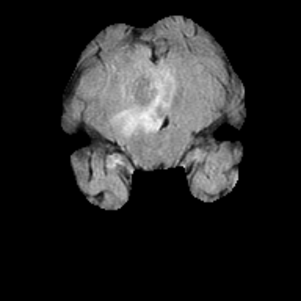</td>
<td>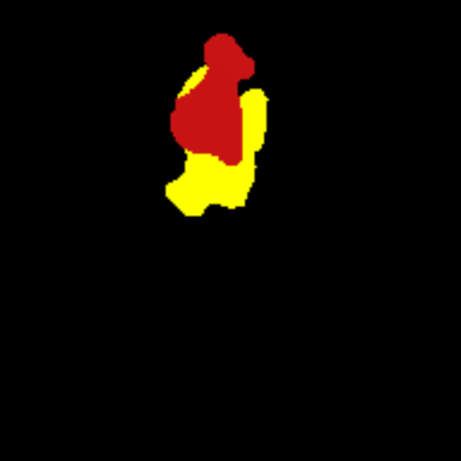</td>
<td>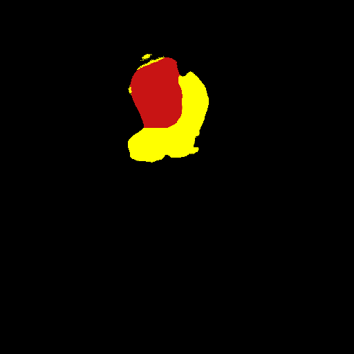</td>
</tr>

<tr>
<td>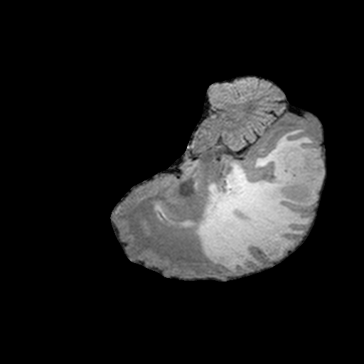</td>
<td>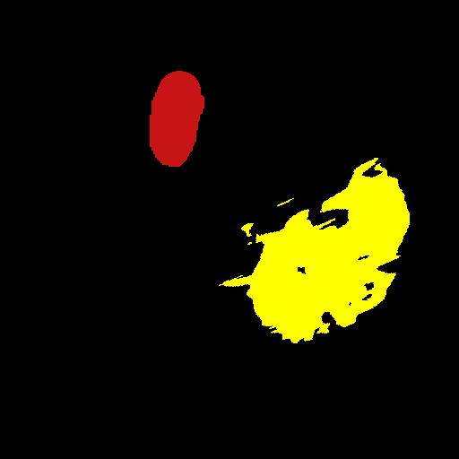</td>
<td>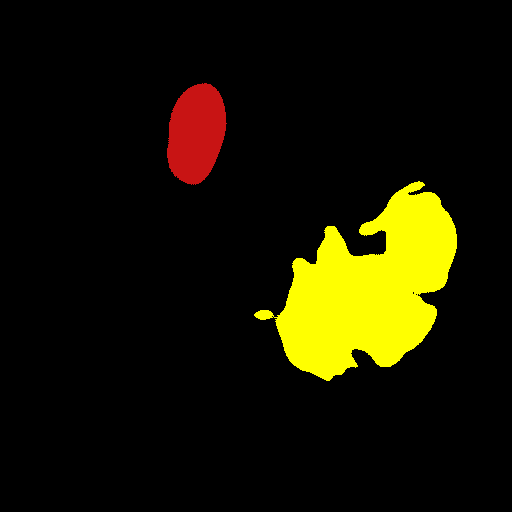</td>
</tr>

<tr>
<td>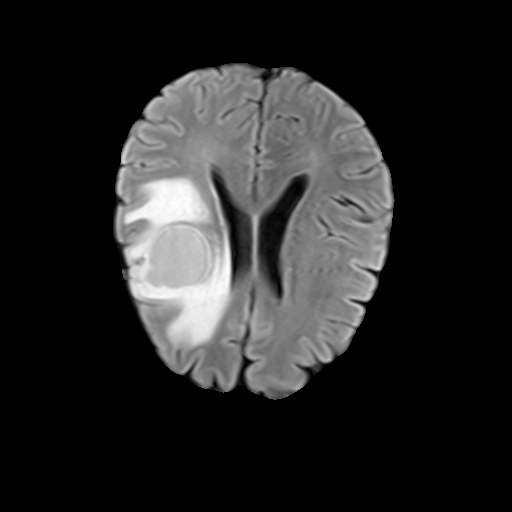</td>
<td>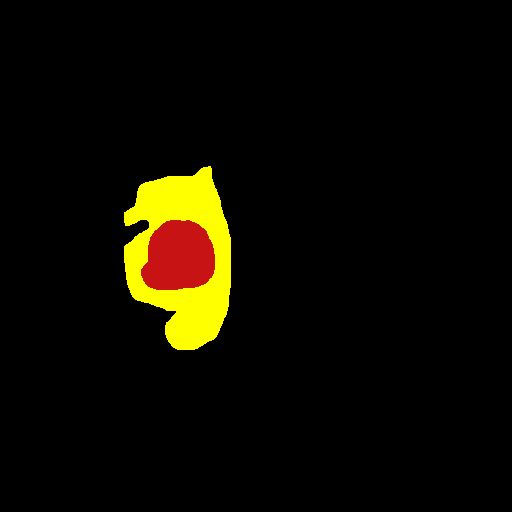</td>
<td>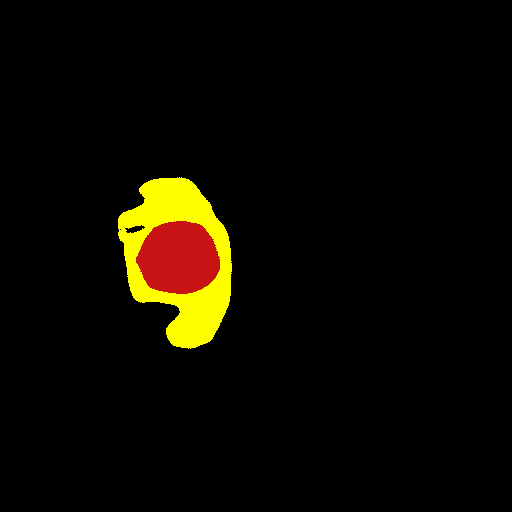</td>
</tr>
</table>

 
<h3>1. Dataset Citation</h3>
The dataset used here was derived from the Kaggle:
  
<a href="https://www.kaggle.com/datasets/mdshahatakash/rad-images-and-segmentations">
Rad Images and Segmentations
</a>
  by Md. Shahat Akash.  
The following explanation was taken from the website above.
  
<b>About Dataset</b> 
Brain-Mets-Lung-MRI-Path-Segs | MR Imaging and Segmentations with Matched Brain Biopsy Pathology 
Slides from Patients with Brain Metastases from Primary Lung Cancer
  
<b>Abstract</b> 
This dataset consists of 111 cases of magnetic resonance (MR) and histopathologic imaging from 
patients with brain metastasis from primary lung cancer. 
We provide pre-operative T1-weighted contrast-enhanced (T1CE) and fluid attenuated inversion 
recovery (FLAIR) MR images with matched whole slide images of formalin-fixed, paraffin-embedded (FFPE)
 brain metastasis biopsies. This dataset also includes segmentations of contrast enhancement 
 and FLAIR hyperintensity, radiomic features, and clinical information.
  
<b>License</b> 
<a href="https://creativecommons.org/licenses/by-sa/4.0/">CC BY-SA 4.0</a>
 
 
<h3>
2. Brain-Metastases-Lung-MRI-Images ImageMask Dataset
</h3>
<h3>
2.1 Download ImageMask Dataset
</h3>
 If you would like to train this Brain-Metastases-Lung-MRI-Images Segmentation model,
 please download the dataset from the google drive  
 <a href="https://drive.google.com/file/d/1sVTjRE8o45hraOP2Jq5o6huD19_P-BM7/view?usp=sharing">
Brain-Metastases-Lung-MRI-ImageMask-Dataset.zip</a>
, expand the downloaded ImageMaskDataset and put it under <b>./dataset</b> folder to be
 
<pre>
./dataset
└─Brain-Metastases-Lung-MRI
    ├─test
    │   ├─images
    │   └─masks
    ├─train
    │   ├─images
    │   └─masks
    └─valid
        ├─images
        └─masks
</pre>
 
<b>Brain-Metastases-Lung-MRI Statistics</b> 
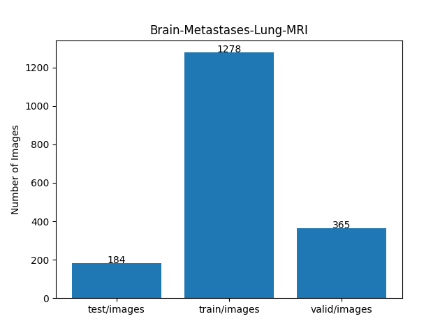 
 
As shown above, the number of images of train and valid datasets is not so large to use for the
 training set of our segmentation model.
 
 
<h3>2.2 Derivation of ImageMask Dataset</h3>
The folder structure of the original dataset is as follows. 
<pre>
./Brain-Mets-Lung-MRI-Path-Segs
    ├─YG_0AXGKD8AFJGS
    │   ├─YG_HAEAKFOSOSWC_core_seg.nii
    │   ├─YG_HAEAKFOSOSWC_flair_img.nii
    │   ├─YG_HAEAKFOSOSWC_t1ce_img.nii
    │   └─YG_HAEAKFOSOSWC_whole_seg.nii
...
    └─YG_ZZD94XZ3WNE2
        ├─YG_HAEAKFOSOSWC_core_seg.nii
        ├─YG_HAEAKFOSOSWC_flair_img.nii
        ├─YG_HAEAKFOSOSWC_t1ce_img.nii
        └─YG_HAEAKFOSOSWC_whole_seg.nii
</pre>		
We generated our own ImageMaskDataset  from the Flair images <b>*_flair_img.nii</b>,
and colorized masks combined with Core masks (dark_red) <b>*_core_seg.nii</b> and 
Whole masks (yellow) <b>*_whole_seg.nii</b>.
by using a simple Python script. 
 
<h3>2.3 Train Sample Images and Masks</h3>
<b>Train_sample_images</b> 
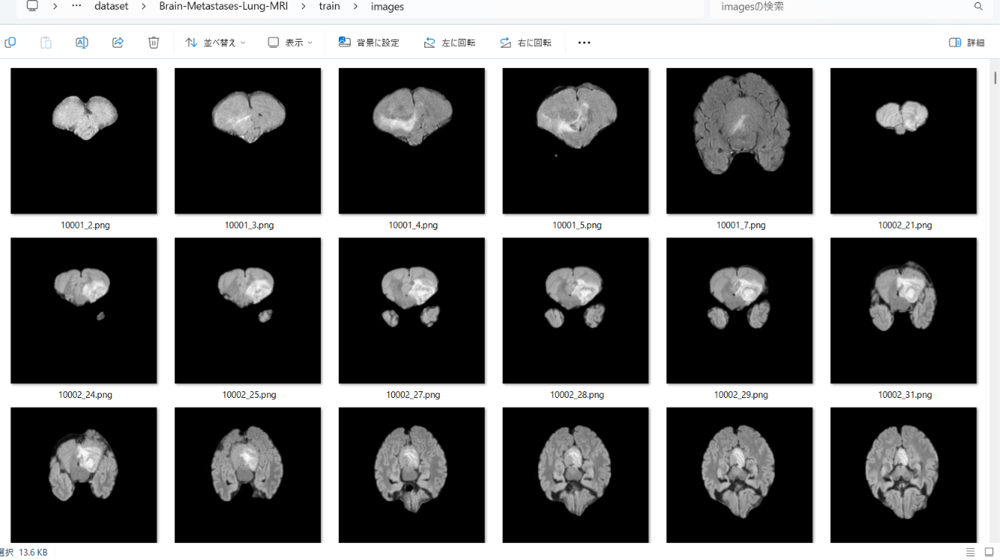
 
<b>Train_sample_masks</b> 
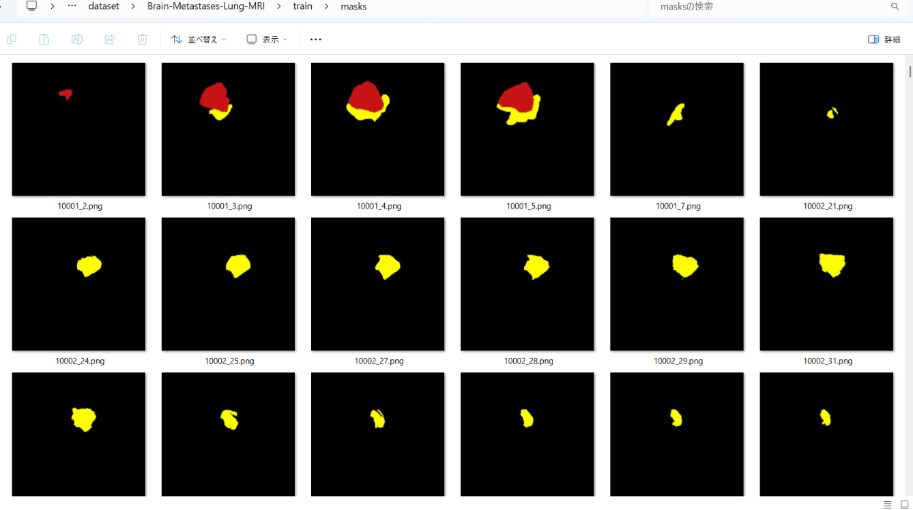
 
<h3>
3. Train TensorFlowFlexUNet Model
</h3>
 We trained Brain-Metastases-Lung-MRI-Images TensorFlowFlexUNet Model by using the following
<a href="./projects/TensorFlowFlexUNet/Brain-Metastases-Lung-MRI/train_eval_infer.config"> <b>train_eval_infer.config</b></a> file.  
Please move to ./projects/TensorFlowFlexUNet/Brain-Metastases-Lung-MRI and run the following bat file. 
<pre>
>1.train.bat
</pre>
This simply runs the following command. 
<pre>
>python ../../../src/TensorFlowFlexUNetTrainer.py ./train_eval_infer.config
</pre>

<b>Model parameters</b> 
Defined a small <b>base_filters=16 </b> and large <b>base_kernels=(11,11)</b> for the first Conv Layer of Encoder Block of 
<a href="./src/TensorFlowFlexUNet.py">TensorFlowFlexUNet.py</a> 
and a large <b>num_layers=8</b> (including a bridge between Encoder and Decoder Blocks).
<pre>
[model]
;You may specify your own UNet class derived from our TensorFlowFlexModel
model         = "TensorFlowFlexUNet"
generator     =  False
image_width    = 512
image_height   = 512
image_channels = 3
num_classes    = 3
base_filters   = 16
base_kernels   = (11,11)
num_layers     = 8
dropout_rate   = 0.03
dilation       = (1,1)
</pre>
<b>Learning rate</b> 
Defined a small learning rate.  
<pre>
[model]
learning_rate  = 0.00007
</pre>
<b>Loss and metrics functions</b> 
Specified "categorical_focal_dice_loss" and <a href="./src/dice_coef_multiclass.py">"dice_coef_hybrid"</a>. 
<pre>
[model]
loss           = "categorical_focal_dice_loss"
metrics        = ["dice_coef_hybrid"]
</pre>
<b>Dataset class</b> 
Specified <a href="./src/ImageCategorizedMaskDataset.py">ImageCategorizedMaskDataset</a> class. 
<pre>
[dataset]
class_name    = "ImageCategorizedMaskDataset"
</pre>
 
<b>Learning rate reducer callback</b> 
Enabled learning_rate_reducer callback, and a small reducer_patience.
<pre> 
[train]
learning_rate_reducer = True
reducer_factor     = 0.4
reducer_patience   = 4
</pre>
<b>Early stopping callback</b> 
Enabled early stopping callback with patience parameter.
<pre>
[train]
patience      = 10
</pre>
<b>RGB Color map</b> 
Specified rgb color map dict for Brain-Metastases-Lung-MRI-Images 3 classes. 
<pre>
[mask]
mask_datatype    = "categorized"
mask_file_format = ".png"
; 1: Core: dark_red
; 2: Whole: yellow
;                      
rgb_map = {(0,0,0):0, (200,20,20):1, (255,255,0):2}
</pre>
<b>Epoch change inference callback</b> 
Enabled <a href="./src/EpochChangeInferencer.py">epoch_change_infer callback</a></b>. 
<pre>
[train]
epoch_change_infer       = True
epoch_change_infer_dir   =  "./epoch_change_infer"
num_infer_images         = 6
</pre>
By using this callback, on every epoch_change, the inference procedure can be called
 for 6 images in <b>mini_test</b> folder. This will help you confirm how the predicted mask changes 
 at each epoch during your training process.  
  
<!--
As shown below, early in the model training, the predicted masks from our UNet segmentation model showed 
discouraging results.
 However, as training progressed through the epochs, the predictions gradually improved. 
   
 -->
<b>Epoch_change_inference output at starting (epoch 1,2,3)</b> 
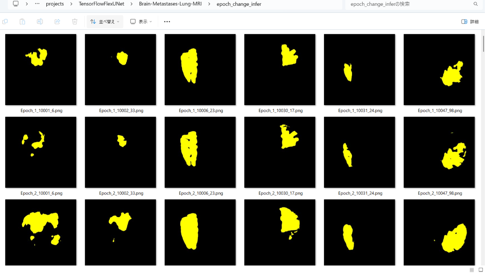 
 
<b>Epoch_change_inference output at middlepoint (epoch 18,19,20)</b> 
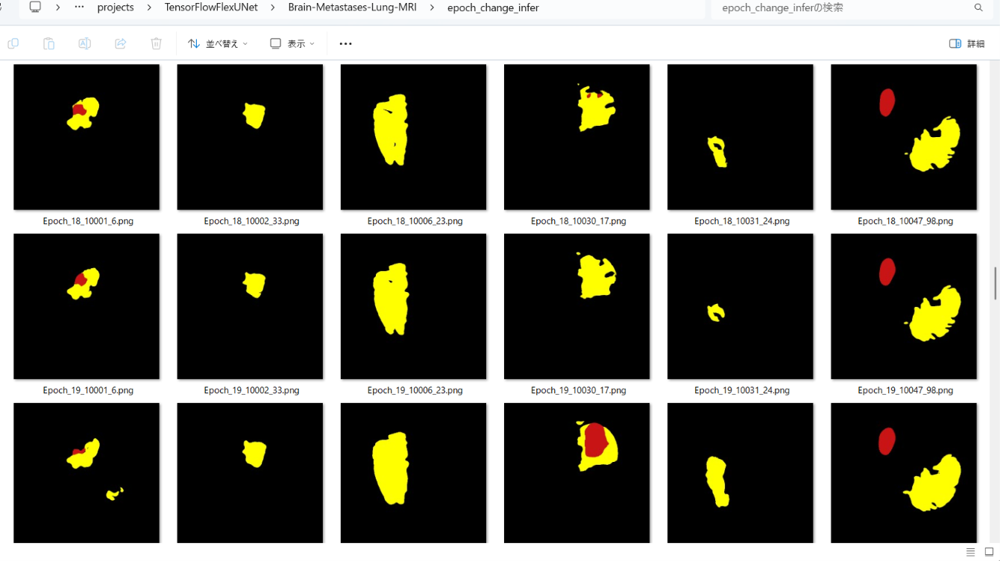 
 

<b>Epoch_change_inference output at ending (epoch 38,39,40)</b> 
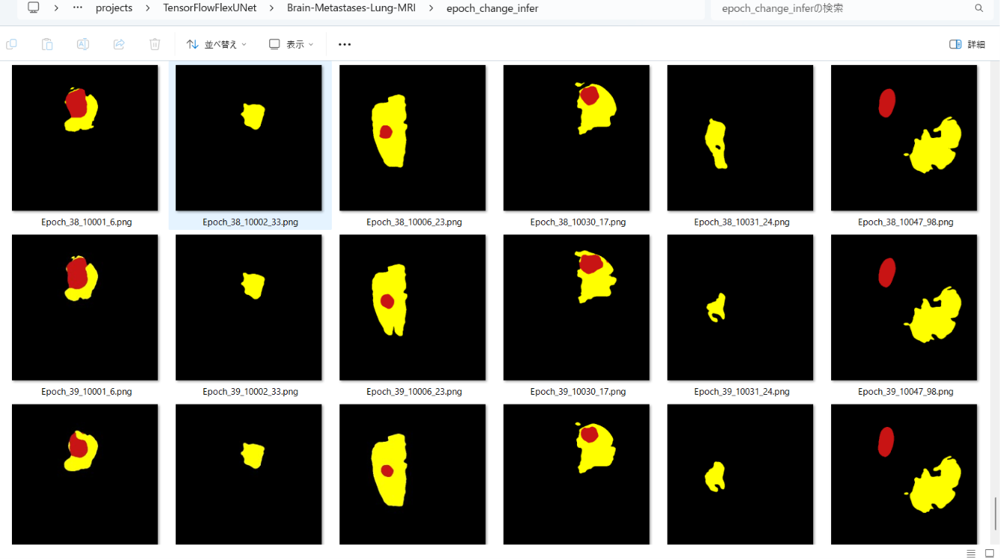 
 
In this experiment, the training process was terminated at epoch 40.  
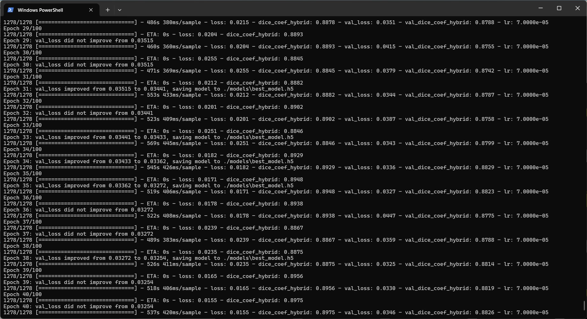 
 
<a href="./projects/TensorFlowFlexUNet/Brain-Metastases-Lung-MRI/eval/train_metrics.csv">train_metrics.csv</a> 
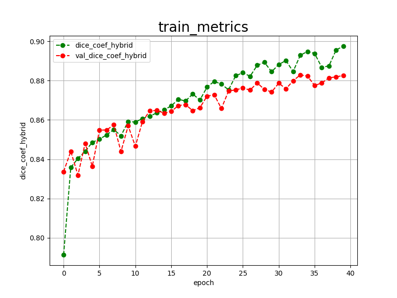 
 
<a href="./projects/TensorFlowFlexUNet/Brain-Metastases-Lung-MRI/eval/train_losses.csv">train_losses.csv</a> 
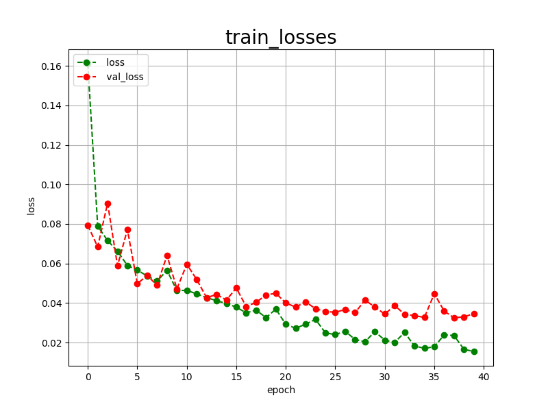 
 
 
<h3>
4. Evaluation
</h3>
Please move to <b>./projects/TensorFlowFlexUNet/Brain-Metastases-Lung-MRI</b> folder, 
and run the following bat file to evaluate TensorFlowUNet model for Brain-Metastases-Lung-MRI-Images. 
<pre>
>./2.evaluate.bat
</pre>
This simply runs the following command.
<pre>
>python ../../../src/TensorFlowFlexUNetEvaluator.py ./train_eval_infer.config
</pre>
Evaluation console output: 
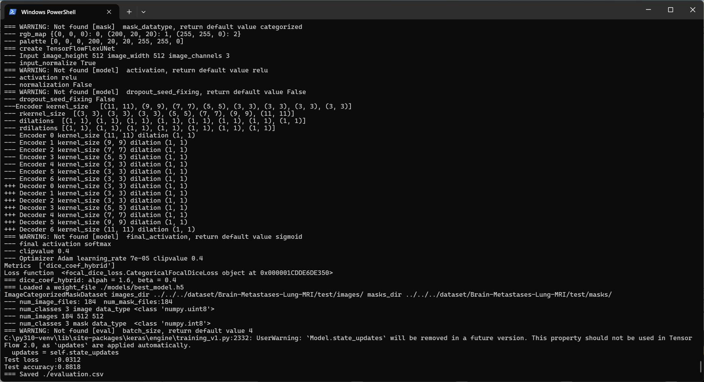
  Image-Segmentation-Brain-Metastases-Lung-MRI-Images
<a href="./projects/TensorFlowFlexUNet/Brain-Metastases-Lung-MRI/evaluation.csv">evaluation.csv</a> 
The loss (categorical_focal_dice_loss to this Brain-Metastases-Lung-MRI-Images/test was low, 
but dice_coef_hybrid 
was not high as shown below.
 
<pre>
categorical_focal_dice_loss,0.0312
dice_coef_hybrid,0.8818
</pre>
 
<h3>
5. Inference
</h3>
Please move to a <b>./projects/TensorFlowFlexUNet/Brain-Metastases-Lung-MRI</b> folder
, and run the following bat file to infer segmentation regions for images by the Trained-TensorFlowUNet model for Brain-Metastases-Lung-MRI-Images. 
<pre>
>./3.infer.bat
</pre>
This simply runs the following command.
<pre>
>python ../../../src/TensorFlowFlexUNetInferencer.py ./train_eval_infer.config
</pre>

<b>mini_test_images</b> 
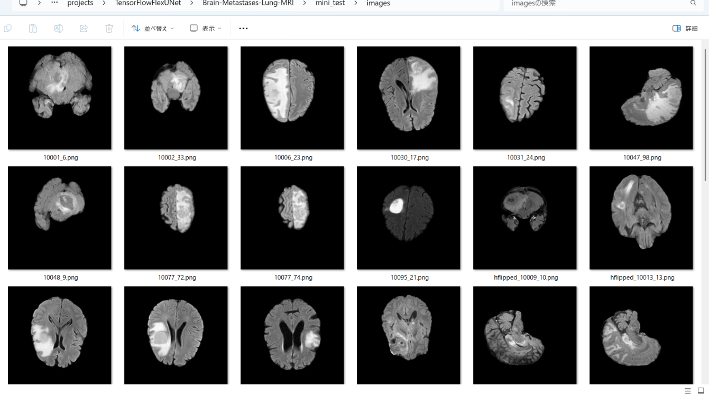 
<b>mini_test_mask(ground_truth)</b> 
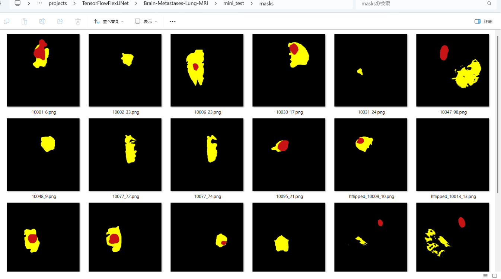 

<b>Inferred test masks</b> 
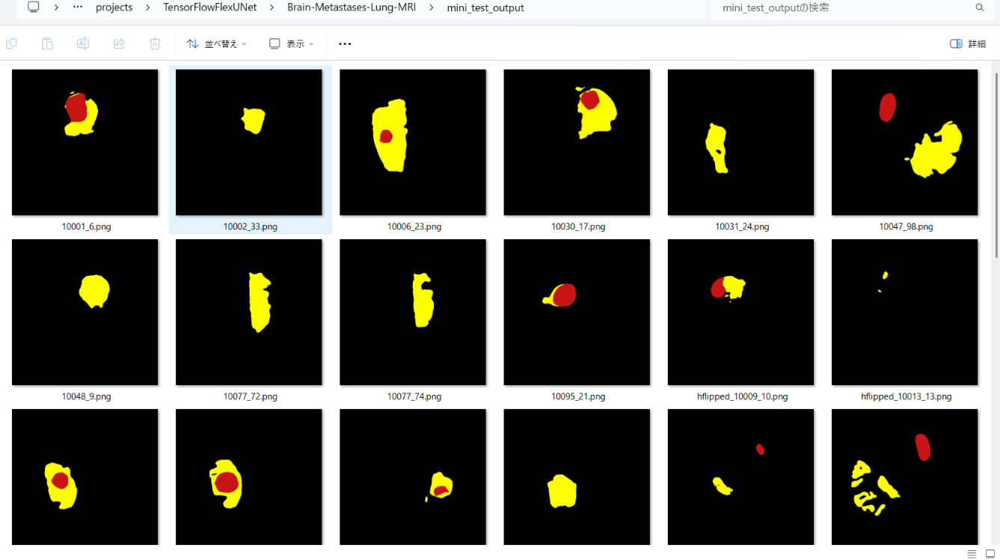 
 

<b>Enlarged images and masks of 512x512-pixel Brain-Metastases-Lung-MRI</b> 
As shown below, the inferred masks look similar to the ground truth masks except for the fifth case. 
 
<b>class_color_map = {Core: dark_red, Whole: yellow}</b>
  
<table>
<tr>
<th>Image</th>
<th>Mask (ground_truth)</th>
<th>Inferred-mask</th>
</tr>
<tr>
<td>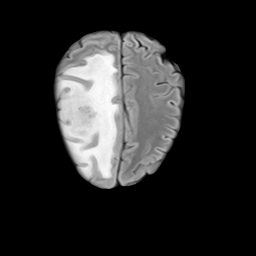</td>
<td>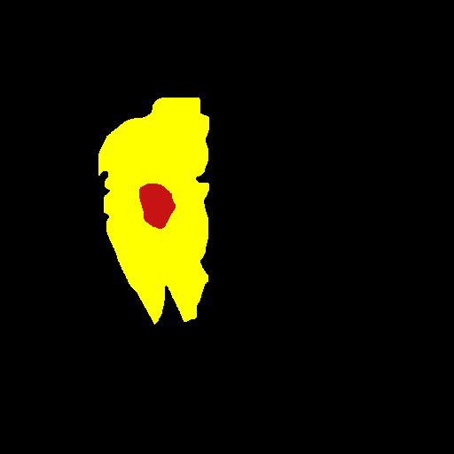</td>
<td>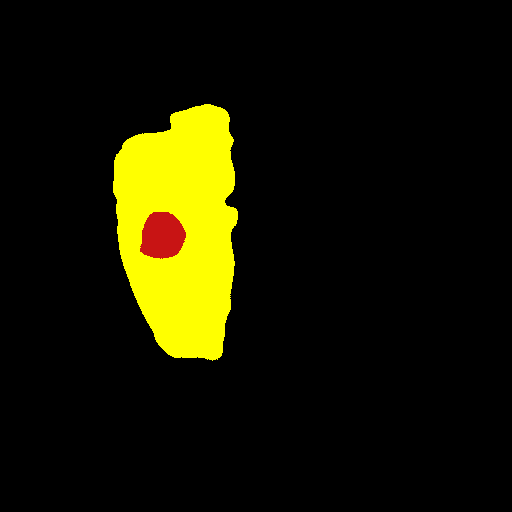</td>
</tr>
<tr>
<td></td>
<td></td>
<td></td>
</tr>
<tr>
<td>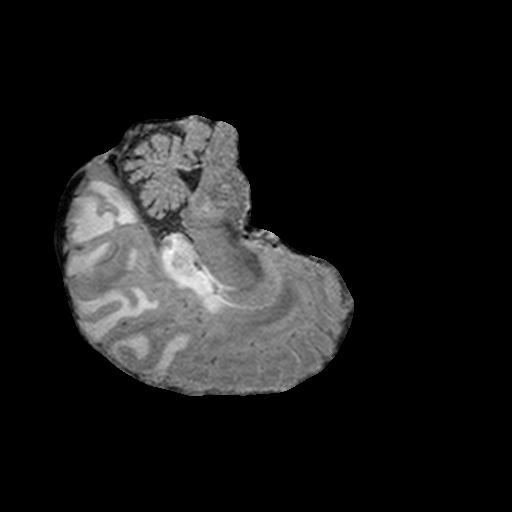</td>
<td>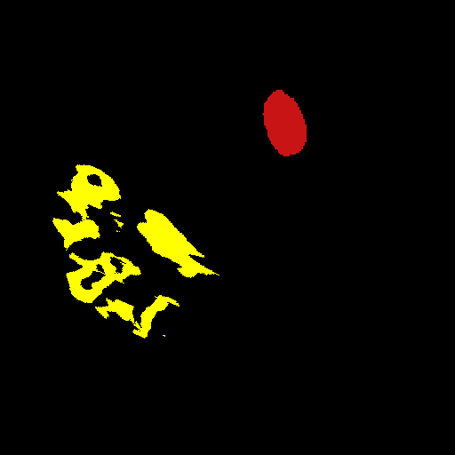</td>
<td>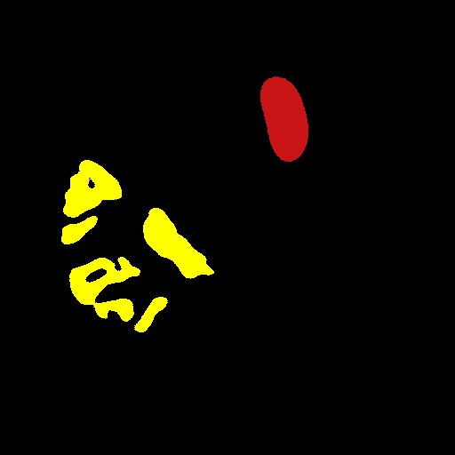</td>
</tr>
<tr>
<td>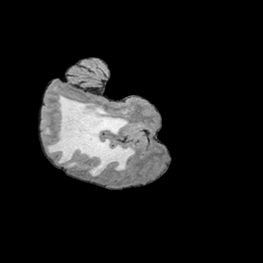</td>
<td>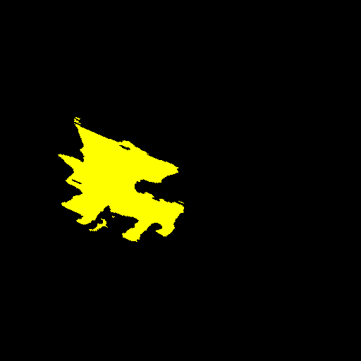</td>
<td>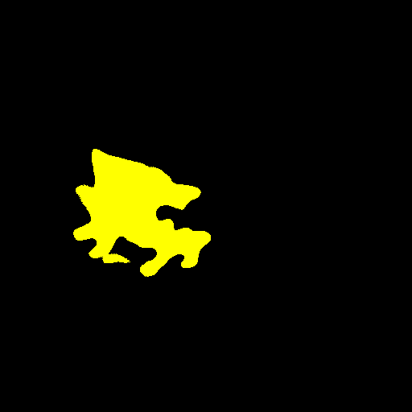</td>
</tr>
<tr>
<td>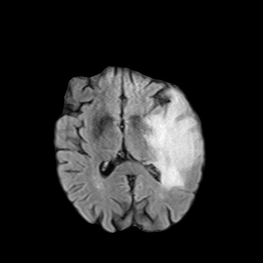</td>
<td>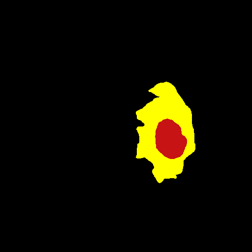</td>
<td>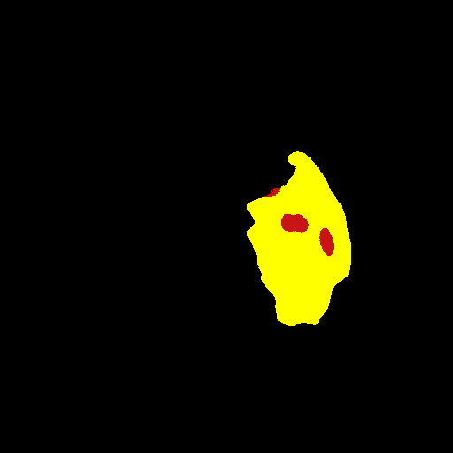</td>
</tr>
<tr>
<td>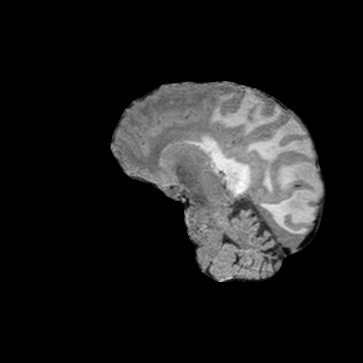</td>
<td>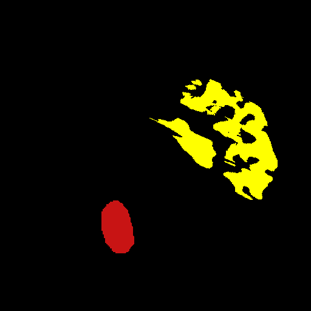</td>
<td></td>
</tr>
</table>

 
<h3>
References
</h3>
<b>1.  The University of California San Francisco Brain Metastases Stereotactic Radiosurgery (UCSF-BMSR) MRI Dataset</b> 
John B Colby, Benjamin Laguna, John Mongan, Steve Braunstein, Christopher P Hess, 
Andreas M Rauschecker, Leo P Sugrue, Javier E Villanueva-Meyer 
<a href="https://pmc.ncbi.nlm.nih.gov/articles/PMC10982817/">
https://pmc.ncbi.nlm.nih.gov/articles/PMC10982817/
</a>
 
 
<b>2. TensorFlow-FlexUNet-Image-Segmentation-Brain-Metastases-MRI-Flair</b> 
Toshiyuki Arai  
<a href="https://github.com/sarah-antillia/TensorFlow-FlexUNet-Image-Segmentation-Brain-Metastases-MRI-Flair">
https://github.com/sarah-antillia/TensorFlow-FlexUNet-Image-Segmentation-Brain-Metastases-MRI-Flair
</a>
  
<b>3. TensorFlow-FlexUNet-Image-Segmentation-Model</b> 
Toshiyuki Arai  
<a href="https://github.com/sarah-antillia/TensorFlow-FlexUNet-Image-Segmentation-Model">
https://github.com/sarah-antillia/TensorFlow-FlexUNet-Image-Segmentation-Model
</a>
 
